[//]: # ()

<p align="center">
    <a href="https://github.com/erupts/erupt"><code><b>[ ERUPT ]</b></code></a>&nbsp;&nbsp;
    <a href="https://github.com/erupts/erupt-web"><code><b>[ ERUPT-WEB ]</b></code></a>&nbsp;&nbsp;
    <a href="https://github.com/lambdakit/Linq.J"><code><b>[ LINQ.J ]</b></code></a>&nbsp;&nbsp;
    <a href="https://www.erupt.xyz"><code><b>[ WEBSITE ]</b></code></a>&nbsp;&nbsp;
    <a href="https://docs.erupt.xyz"><code><b>[ DOCS ]</b></code></a>&nbsp;&nbsp;
    <a href="https://demo.erupt.xyz"><code><b>[ DEMO ]</b></code></a>&nbsp;&nbsp;
    <a href="https://skill.erupt.xyz"><code><b>[ AI SKILL ]</b></code></a>
</p>

## `› cat less-code.java`

An admin system is one annotated entity. Add a field, refresh, it shows up — paged, searchable, exportable, role-gated.

```java
@Erupt(
    name   = "Developer",
    desc   = "Less code, more power.",
    prompt = "Ask me anything about erupt.",
    power  = @Power(delete = false)
)
@Entity
public class Developer extends BaseModel {

    @EruptField(
        views = @View(title = "Name"),
        edit  = @Edit(title = "Name", search = @Search)
    )
    private String name = "YuePeng";

    @EruptField(
        views = @View(title = "Domain"),
        edit  = @Edit(title = "Domain", type = EditType.TAGS)
    )
    private String[] domain = {"Low-Code", "Big Data", "CDP", "Data Platform", "E-Commerce", "AI"};

    @EruptField(
        views = @View(title = "Stack"),
        edit  = @Edit(title = "Stack", type = EditType.TAGS)
    )
    private String[] stack = {"Java", "Spring", "Angular", "TypeScript", "Flink", "Spark", "ClickHouse", "LLM"};

    @EruptField(
        views = @View(title = "Stars"),
        edit  = @Edit(title = "Stars")
    )
    private Integer stars = 10_000;
}
```

```bash
mvn spring-boot:run        # → http://localhost:8080  (erupt / erupt)
```

No local setup? [start.erupt.xyz](https://start.erupt.xyz) builds the project in your browser. No engineering background? Tell Claude Code `"Build me a CRM admin panel"` with the [erupt skill](https://skill.erupt.xyz) installed.

## `› cat how-i-think.md`

- **Less is more** — the best framework is the one you barely notice.
- **Abstraction over accumulation** — complex problems usually hide a simple model; find it, don't pile code on it.
- **Rewrite without regret** — never married to an implementation, always open to a better one.
- **Ship the runtime, not the generator** — generated code is debt with a nicer name; render from metadata and stay rewritable.